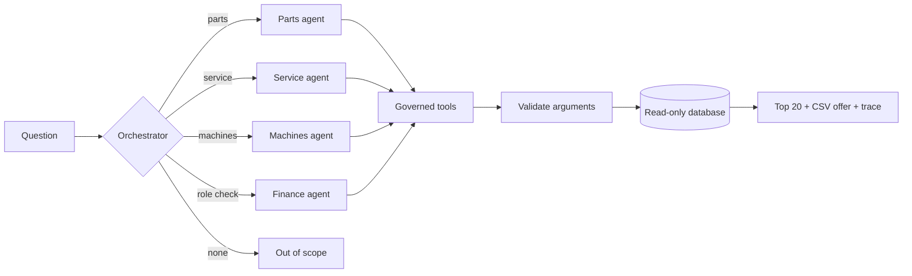

# governed-agents

A multi-agent assistant for business data where **the model picks tools and never writes SQL**.

[Leia em português](README.pt-BR.md)

This is a clean rebuild of a pattern I run in production on a corporate agent platform. The company, data and code here are all fictional: **AgroDemo Máquinas** is an invented farm-equipment dealership, and every number comes from a fixed random seed.

## Why it exists

Pointing a language model at a database gives you a great demo and a bad system. It will eventually write a query that is valid, fast and wrong, and nobody will notice. So this project moves everything that must be right out of the model and into plain code:

| Rule | Where it is enforced |
|---|---|
| The model chooses a tool. It never writes SQL. | Fixed queries in [`catalog.py`](src/governed_agents/catalog.py), bound parameters in [`tools.py`](src/governed_agents/tools.py) |
| Every argument is validated before it reaches the database. | `Param.clean`, plus a read-only connection |
| An agent can only call its own tools. | `Assistant._call_tool` |
| Sensitive areas are limited by role, before any model call on that agent. | `Agent.allowed_roles` |
| The chat shows the top 20. The full detail goes to a CSV. | `CHAT_TOP_N`, `Tool.export_csv` |
| The offer of the full detail is added by the runtime, not left to the model. | `Assistant.ask` |
| Each tool says when *not* to use it, naming the sibling that owns that case. | A test fails if the clause is missing |
| Every run leaves a trace of what was called, with what, and what came back. | `Turn.trace` |

## How it works



There are two brains behind one interface:

- **`RuleBrain`** routes by keyword and answers from templates. It needs no key and no network, so the tests, the CI and the [demo on my site](https://montinilucas.github.io) run on it.
- **`ClaudeBrain`** is the real model, on a hand-written loop so the runtime can trace each call, cap the turns and send tool errors back for the model to correct.

## Run it

Requires Python 3.12+. Everything except `--brain claude` works offline.

```bash
pip install -e ".[dev]"
python -m governed_agents ask "Quais OSs estão abertas há 90 dias na filial Leste?"
```

```text
[route] {'agent': 'service'}
[tool_call] {'tool': 'service_aged_orders', 'args': {'min_age_days': 90, 'branch': 'Leste'}, 'rows_shown': 20, 'total_rows': 28, 'elapsed_ms': 1.0}

28 OSs abertas há 90 dias ou mais. A mais antiga é a 1237, da filial Leste, com 719 dias.
Mostrando 20 de 28 linhas. Quer o detalhe completo em CSV?
```

Other commands:

```bash
python -m governed_agents ask "Quanto temos de títulos vencidos a receber?" --role seller
python -m governed_agents ask "Quais os itens mais vendidos no FY2026?" --csv reports/items.csv
python -m governed_agents evals
pytest
```

With an Anthropic API key, the same commands take `--brain claude`.

## Evals

[`evals/golden.json`](evals/golden.json) holds 16 questions, each with the agent, tool and arguments it should produce, including questions that must be refused for the user's role or for being out of scope. `python -m governed_agents evals` scores any brain against them.

## What is and isn't tested

- `RuleBrain` passes all 16 golden cases, and that runs in CI.
- `ClaudeBrain` is covered by a scripted client: the loop, parallel tool calls, tool errors, the turn limit, refusals and the structured routing request. **That does not measure the real model's accuracy.** Running `evals --brain claude` does, and it costs API credit, so it is not part of CI and I have not published a score.

## What this is not

It reproduces the design, not the production system. The real one runs on Microsoft Copilot Studio and Power Automate, with DAX templates over Power BI semantic models instead of SQLite, and more agents and tools. The rules above are the part that carries over.

## License

MIT
