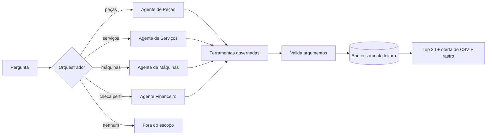

# governed-agents

Assistente multiagente para dados de negócio em que **o modelo escolhe ferramentas e nunca escreve SQL**.

[Read in English](README.md)

É uma reconstrução limpa de um padrão que uso em produção numa plataforma corporativa de agentes. A empresa, os dados e o código aqui são todos fictícios: a **AgroDemo Máquinas** é uma concessionária inventada, e todo número sai de uma semente aleatória fixa.

## Por que existe

Ligar um modelo de linguagem direto no banco rende uma ótima demonstração e um sistema ruim. Uma hora ele escreve uma consulta válida, rápida e errada, e ninguém percebe. Por isso, este projeto tira do modelo tudo o que precisa estar certo e coloca em código comum:

| Regra | Onde é garantida |
|---|---|
| O modelo escolhe uma ferramenta. Nunca escreve SQL. | Consultas fixas em [`catalog.py`](src/governed_agents/catalog.py), parâmetros vinculados em [`tools.py`](src/governed_agents/tools.py) |
| Todo argumento é validado antes de chegar ao banco. | `Param.clean`, mais conexão somente leitura |
| Um agente só chama as próprias ferramentas. | `Assistant._call_tool` |
| Áreas sensíveis são limitadas por perfil, antes de qualquer chamada ao agente. | `Agent.allowed_roles` |
| O chat mostra o top 20. O detalhe completo vai para um CSV. | `CHAT_TOP_N`, `Tool.export_csv` |
| A oferta do detalhe completo vem do runtime, não depende do modelo. | `Assistant.ask` |
| Cada ferramenta diz quando *não* deve ser usada, citando a vizinha responsável. | Um teste falha se a cláusula faltar |
| Toda execução deixa o rastro do que foi chamado, com quais argumentos e o que voltou. | `Turn.trace` |

## Como funciona



São dois "cérebros" atrás da mesma interface:

- **`RuleBrain`** roteia por palavra-chave e responde por modelo de texto. Não precisa de chave nem de rede, então os testes, o CI e a [demo do meu site](https://montinilucas.github.io) rodam nele.
- **`ClaudeBrain`** é o modelo de verdade, num loop escrito à mão para o runtime rastrear cada chamada, limitar os turnos e devolver erros de ferramenta para o modelo corrigir.

## Como rodar

Requer Python 3.12+. Tudo funciona offline, menos `--brain claude`.

```bash
pip install -e ".[dev]"
python -m governed_agents ask "Quais OSs estão abertas há 90 dias na filial Leste?"
```

```text
[route] {'agent': 'service'}
[tool_call] {'tool': 'service_aged_orders', 'args': {'min_age_days': 90, 'branch': 'Leste'}, 'rows_shown': 20, 'total_rows': 28, 'elapsed_ms': 1.0}

28 OSs abertas há 90 dias ou mais. A mais antiga é a 1237, da filial Leste, com 719 dias.
Mostrando 20 de 28 linhas. Quer o detalhe completo em CSV?
```

Outros comandos:

```bash
python -m governed_agents ask "Quanto temos de títulos vencidos a receber?" --role seller
python -m governed_agents ask "Quais os itens mais vendidos no FY2026?" --csv reports/items.csv
python -m governed_agents evals
pytest
```

Com uma chave da API da Anthropic, os mesmos comandos aceitam `--brain claude`.

## Avaliações

[`evals/golden.json`](evals/golden.json) tem 16 perguntas, cada uma com o agente, a ferramenta e os argumentos esperados, incluindo perguntas que precisam ser recusadas pelo perfil do usuário ou por estarem fora do escopo. `python -m governed_agents evals` mede qualquer cérebro contra elas.

## O que está e o que não está testado

- O `RuleBrain` passa nos 16 casos, e isso roda no CI.
- O `ClaudeBrain` é coberto por um cliente roteirizado: o loop, chamadas paralelas, erros de ferramenta, o limite de turnos, recusas e a chamada de roteamento estruturado. **Isso não mede a precisão do modelo real.** Quem mede é `evals --brain claude`, que consome crédito de API, então não faz parte do CI e não publiquei uma nota.

## O que isto não é

Reproduz o desenho, não o sistema de produção. O real roda em Microsoft Copilot Studio e Power Automate, com templates DAX sobre modelos semânticos do Power BI em vez de SQLite, e com mais agentes e ferramentas. As regras acima são o que se transfere.

## Licença

MIT
